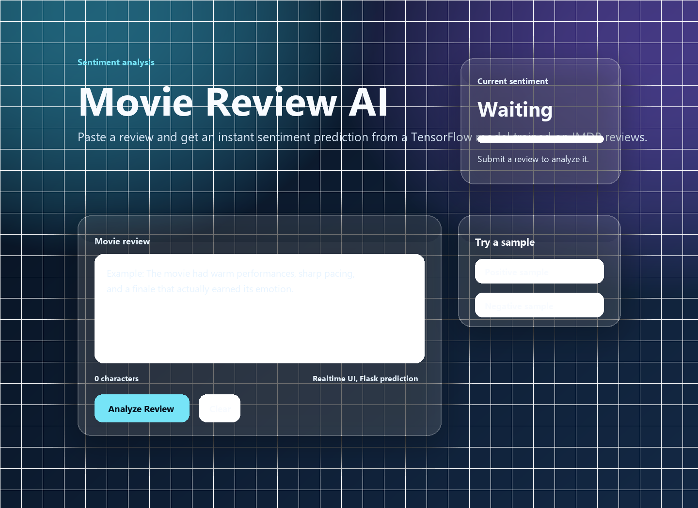
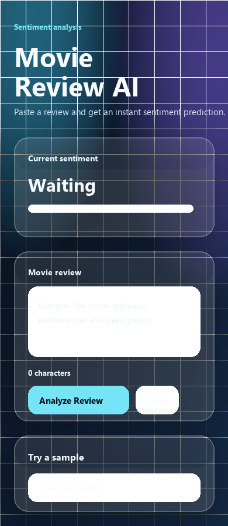

# Movie Review AI

A Flask web app that predicts whether a movie review sounds positive or negative. The backend loads `sentiment_model.keras`, converts raw text into the same IMDB word-index format used during training, and returns the prediction to a glassmorphism browser UI.

## Screenshots

### Desktop



### Mobile



## Features

- Flask backend with a `/predict` JSON endpoint
- TensorFlow/Keras model loading from `sentiment_model.keras`
- Glassmorphism web UI built with CSS and vanilla JavaScript
- Responsive desktop and mobile layouts
- Live character count, loading state, sample reviews, and sentiment confidence meter
- Training script in `model.py` for rebuilding the saved model

## Project Structure

```text
movie_review_ai/
  app.py
  model.py
  requirements.txt
  sentiment_model.keras
  readme.md
  docs/
    screenshots/
      desktop.png
      mobile.png
  static/
    app.js
    styles.css
  templates/
    index.html
```

## Setup

Create and activate a virtual environment:

```bash
python -m venv .venv
.venv\Scripts\activate
```

Install dependencies:

```bash
pip install -r requirements.txt
```

## Run the Web App

```bash
python app.py
```

Open the app through Flask:

```text
http://127.0.0.1:5000
```

Do not open `templates/index.html` directly for normal use. The model runs on the Flask server, and the UI sends requests to that server.

## API Usage

Send a POST request to `/predict`:

```bash
curl -X POST http://127.0.0.1:5000/predict ^
  -H "Content-Type: application/json" ^
  -d "{\"review\":\"A smart, emotional film with excellent performances.\"}"
```

Example response:

```json
{
  "confidence": 0.8421,
  "label": "Positive",
  "percent": 84.2,
  "score": 0.8421
}
```

## Retrain the Model

The existing `sentiment_model.keras` file is already included. To retrain and overwrite it:

```bash
python model.py
```

The training script downloads the Keras IMDB dataset, trains a small neural network, evaluates it, and saves the model back to `sentiment_model.keras`.

## Troubleshooting

If the page looks unstyled, open it from `http://127.0.0.1:5000` and hard refresh with `Ctrl + F5`.

If prediction shows a fetch error, make sure Flask is running with:

```bash
python app.py
```

Then use:

```text
http://127.0.0.1:5000
```

## Notes

- The model was trained on the Keras IMDB dataset, so the app maps review text to the same IMDB vocabulary before prediction.
- Predictions are educational/demo quality and should not be treated as a production moderation system.
